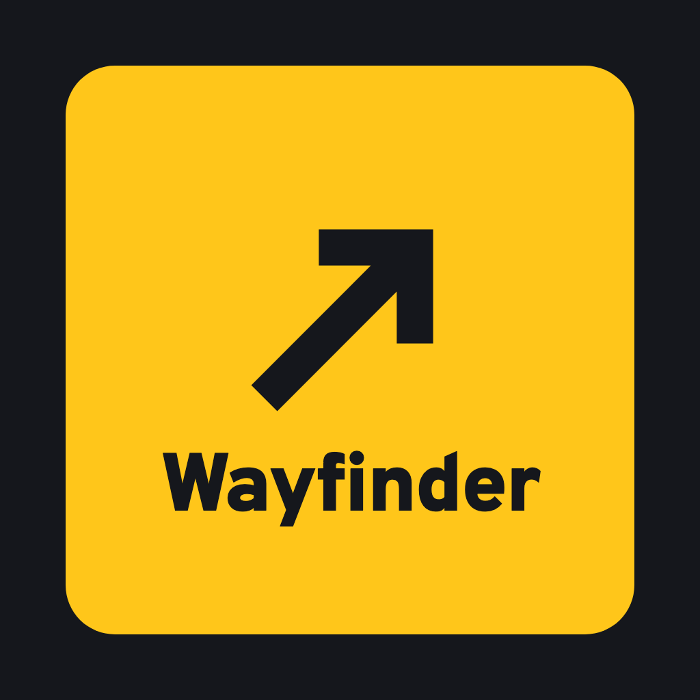

# Wayfinder



**You lead when you can. It leads when you need.**

A robot guide for people who are losing their sight. The user leads whenever they can. Wayfinder reads how they are doing through the handle, steps in only when they need it, and says why. Built solo by Anusha Upadhyay for AgentVerse 2026, Robotics track. Simulated in MuJoCo; every decision runs on a laptop CPU with no network.

**Demo video:** [`runs/Wayfinder demo.mp4`](runs/Wayfinder%20demo.mp4). One continuous take of a remembered route: it stops at the open hatch, re-plans around a sign put down mid-run, hands the lead to the user once the drop is behind them, and takes it back when someone crosses, saying why each time. On a first journey the hatch is not on its map at all; it finds the missing floor with its own camera.

**One-page technical summary:** [`onepager/Wayfinder - technical summary.pdf`](onepager/Wayfinder%20-%20technical%20summary.pdf)

## For judges: where each criterion is covered

| Criterion | Where to look |
|---|---|
| Perception-driven action (25%) | [How it works](#how-it-works): every move comes from the depth camera, sensor ring and handle, and is re-planned 2 to 4 times a second |
| Adaptation to change (25%) | [Adapting mid-run](#adapting-mid-run): unmapped drop, a new object on a remembered route, crowds, and control moving between user and robot |
| Operational autonomy (15%) | [Edge budget](#edge-budget) and [When it is unsure](#safety-and-the-critical-failure-mode) |
| Relevance and impact (20%) | [The problem](#the-problem) and [the critical failure mode](#safety-and-the-critical-failure-mode): a drop, handled on screen |
| Ambition and technical quality (15%) | [What's new](#whats-new), [Evaluation](#evaluation), [Limits](#limits) |

## The problem

Who it is for: people who have recently lost their sight, mostly older adults with glaucoma or macular degeneration, in the gap between diagnosis and help. Nearly 80% of the UK's 2M+ people with sight loss are 65 or older [1].

- 85% of councils did not complete vision rehabilitation assessments within RNIB's recommended 28 days; some people wait over a year [2].
- 980 people are waiting for a guide dog; 553 new partnerships were made in 2025, over 40% of them with people who had waited more than two years [3].
- At stations, 60% of blind and partially sighted passengers are not consistently met by staff, even when they booked assistance in advance [4].
- Blind people memorise their regular routes. RNIB says changes to them must be communicated accessibly, and 56% name temporary obstacles as a barrier [6].

> "When I got lost, I was too scared to go out. I lost all my confidence." Jennie [3]
>
> "I know the assistance is going to fail. No one meets me." Paul Goddard [4]

The pain is lost confidence, which keeps people indoors. A glaucoma specialist told us her patients talk most about losing independence (personal communication).

## What's new

Robot guides that avoid obstacles and predict crowds already exist: CaBot (CMU/IBM, 2020) and Glidance Glide. Some already share control: Ye et al.'s Co-Robotic Cane switches between leading and following from how the user moves with it, and Cai et al. (HRI 2026) switch to following when the user reaches for a door or button. None that we found decides who leads from how the user is coping and how well they know the route.

- **Control moves both ways, from the user's state and the route.** Wayfinder shifts control between user and robot from tension in the user's grip together with how familiar the route is. Calm on a known route, with any known drop behind them: the user steers and Wayfinder only watches out. Tense, busy or near danger: it takes over and says why.
- **Existing user-led modes are chosen by the user.** Glide and CaBot (Kamikubo et al., CHI 2025) have user-led modes, but the user picks the mode.
- **No graduating.** Sight loss is permanent and confidence changes day to day, so control adapts in both directions rather than weaning anyone off help. Users in guide studies wanted control, not to be dragged.

This is "as far as we could find" from a search of products and research up to November 2026, not a systematic review.

## How it works

Sense > perceive > map > track and predict > plan > decide > act and speak, every 40 ms.

1. **Sense.** One forward depth camera (160×120, 25 Hz), a ring of 9 short-range distance sensors, and handle grip.
2. **Perceive.** Each depth pixel becomes a 3D point labelled floor, obstacle or missing floor (below floor level).
3. **Map.** 25 cm grid. Walls and pillars are known in advance; everything else is learned live. Drops are never forgotten. Route memory is saved per journey.
4. **Track and predict.** Moving blobs are tracked. Constant-velocity prediction 2 s ahead [7], with uncertainty that grows over time and with how erratic each person is. It avoids where people will be when it gets there, not where they are now, to avoid the freezing robot problem [9].
5. **Plan.** A* with safety margins (50 cm from obstacles, 85 cm from drops, predicted people), re-planned 2 to 4 times a second. Switching sides costs extra, so it commits to a side instead of dithering.
6. **Decide.** A lead or shadow policy from route familiarity and user tension. An independent safety layer can always override it.
7. **Act and speak.** Steering plus on-device speech, one line at a time like a person. Lines wait their turn; only safety warnings cut in.

**Reading the person.** Grip force and how the user follows give a tension estimate, calibrated to each person so it works with weak or arthritic grips. When the user is tense it slows down and describes what is around; when they are calm it talks less.

## Adapting mid-run

Each run has random crowds and random events, so nothing is scripted.

- **Unmapped drop.** The open floor hatch is not on the map. When the camera labels missing floor, the drop goes on the map for good and the route is re-planned around it: "Open drop 4 metres ahead. Going around it on the left."
- **Something new on a remembered route.** On journey 2 a sign that was not there on journey 1 is placed at a random point on the route. Wayfinder compares what it sees with its route memory and says "Something new on this route since last time, 4 metres ahead on your left."
- **Blocked route.** "Something's blocking our route. Going around on the right."
- **Crowds.** "People crossing ahead. Adjusting our route." An erratic walker gets more room: "Someone ahead keeps changing direction. Slowing down."
- **Control changes hands.** "You know this way. You lead, and I'll watch out for you." If the user steps toward the drop or tenses up: "I'll take over for a bit." When things settle: "Back to you."

## Safety and the critical failure mode

The most critical failure is leading someone off an edge (a platform edge, an open hatch, stairs down). Visually impaired people make up 9 to 15% of platform falls with no train present, against about 3% of the population [5].

- Missing floor is labelled directly from depth, with an 85 cm planning margin, and drops are never forgotten.
- A separate safety layer stops the robot whenever missing floor is within 1.4 m ahead, whatever the planner or the user wants. Like a guide dog's intelligent disobedience, it refuses and explains.
- In shadow mode, if the user heads for the drop it takes over: "Stop. There's a drop that way. Bear left."
- It keeps personal space and waits when someone is right next to the user.

**When it is unsure, it stops and says so:**
- camera loses most of its picture: "I can't see properly. Stopping."
- no safe route: "I can't find a safe way through. Let's wait for help."
- user lets go of the handle: "Handle released. Stopping."

## Edge budget

Stated budget: one CPU core, a 40 ms control cycle (25 Hz), no GPU, no network.

| Part | Where | Time |
|---|---|---|
| Depth labelling and mapping | CPU | under 1 ms per frame |
| Tracking and 2 s prediction | CPU | under 1 ms per frame |
| A* re-plan (80×40 grid) | CPU | about 13 ms, 2 to 4 times a second |
| Speech | on-device TTS | no network |

Measured on a laptop CPU: a typical decision step takes under 1 ms, and the worst-case re-plan about 13 ms (a third of the budget). The whole simulation, including camera rendering, runs about 5 times faster than real time.

## Evaluation

Random crowds and events, 40 runs per journey. Raw results are in `results/`.

| Run set | Arrived | Robot-caused contacts | Closest to the drop | Closest to a person |
|---|---|---|---|---|
| Journey 1, new route | 40/40 | 0 | 0.83 m | 0.44 m |
| Journey 2, remembered route | 40/40 | 0 | 0.97 m | 0.56 m |

On journey 2 it handed the lead to the user in 29 of 40 runs (it holds the lead while a known drop is on the next 6 m of the route), and took control back from a step toward the drop in 3. It reported the new sign in 18 of 40 runs; in the rest the sign was outside the camera's view or behind a crowd.

**Prediction horizon**, same 20 random crowds: no prediction, 2 s and 4 s all had 0 contacts, because the safety layer holds the distance on its own. 4 s stopped 35% more often than 2 s and arrived 7% later, so Wayfinder uses 2 s. The job of prediction is to yield early instead of freezing. (CaBot, tested with users, used 4 s [8].)

## Limits

- Simulation only: perfect sensors, no wheel slip. Real depth cameras fail on glass and shiny floors, so a real build adds close-range sensing.
- Tension is a modelled handle signal. It needs validating with real users.
- Constant-velocity prediction. A Kalman filter or learned predictor is the next step.
- Indoor concourse only. Outdoor kerbs, crossings and stairs are future work.
- Not yet tested with blind users. Next: co-design sessions, as Guide Dogs already runs with tech companies.

## Run it

```
python3 -m venv venv && venv/bin/pip install -r requirements.txt
venv/bin/python guide_sim.py --fresh --people 5   # journey 1 (forgets the route first)
venv/bin/python guide_sim.py --people 5           # journey 2: remembers, hands control back
venv/bin/python guide_sim.py --show               # live window
venv/bin/python guide_sim.py --headless --seed 4  # safety metrics only
./eval.sh                                         # the 80-run evaluation
```

Runs are saved to `runs/`. `--seed N` repeats an exact run.

## Sources

1. RNIB, key statistics.
2. RNIB, *Life on Pause*, FOI report, October 2025.
3. Guide Dogs, Annual Report 2025.
4. RNIB, Platform for Change (rail report), via Optometry Today, 22 January 2026.
5. RAIB, Eden Park report, 2021.
6. RNIB, *In My Way*, 2025.
7. Schöller et al., *What the Constant Velocity Model Can Teach Us About Pedestrian Motion Prediction*, RA-L 2020.
8. Kayukawa et al., guiding blind users through crowds with a suitcase robot (CaBot), IMWUT 2020.
9. Trautman and Krause, *Unfreezing the robot*, IROS 2010.
